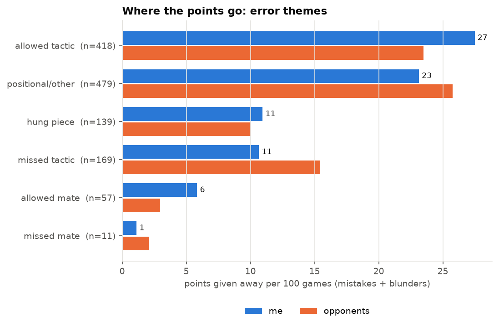
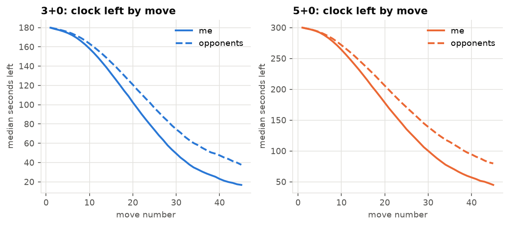
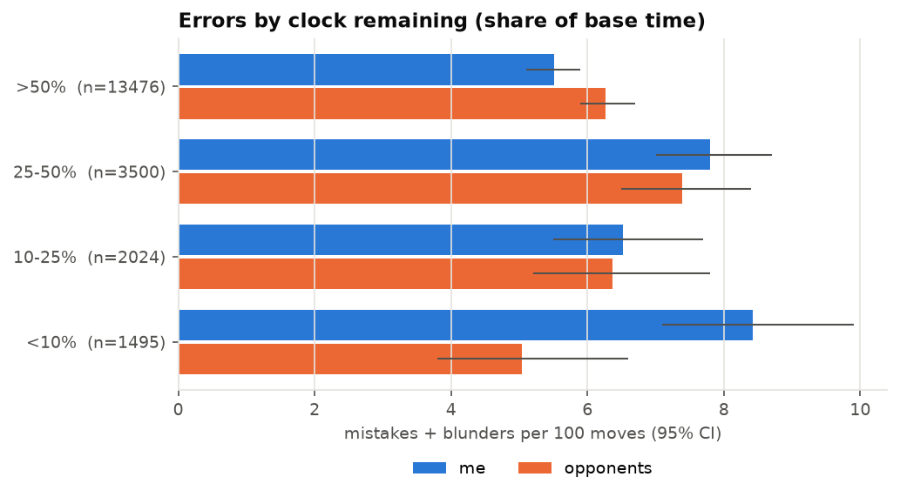

# Blitz improvement report: MatthewSharpe99

*Generated 2026-11-12 from 13,747 rated blitz games (Feb 2021 to Nov 2026). Stockfish 19 analysed the most recent 600 of them (300 at 3+0 and 300 at 5+0, 20,495 of my moves) at depth 16.*

## TL;DR

- **My biggest leak is not checking what my opponent threatens.** Moves that allow a tactic or a mate cost me about **54 Elo compared with same-rated opponents** (95% CI 23 to 87), at both time controls. My hunch about blunders was half right. One-move hung pieces are only slightly worse than my peers' (+7 Elo, not significant). The leak is the *two- to four-move* tactic and the mating attack I don't see coming. Most of these happen **with plenty of time on the clock**, so this is a thinking habit, not a speed problem.
- **At 3+0, I spend too much clock early and lose on time.** In my last 300 3+0 games I lost 60 on time, 19 of them from winning positions. I won only 24 on time. That is about **51 Elo of net damage at 3+0**. I'm 24 Elo weaker at 3+0 than at 5+0 (CI 13 to 36), and the gap has widened to about 48 Elo since late 2024.
- **Strengths: finding my own tactics** (40 Elo *better* than peers), quiet positional play, openings and endgames, which are all at or above my rating. I don't show any tilt.
- **Plan (90 min/week):** puzzles from the *defender's* side, drilling my own blunder positions, and slower practice games that build a 3-second "what does that move threaten?" check. Add clock checkpoints for 3+0.

## How to read the numbers

- **Score vs expected:** actual score minus the score the Elo formula predicts from the two ratings. 0.01 points per game ≈ 7 Elo. chess.com's archives store *post-game* ratings; I rebuilt pre-game ratings, because otherwise the result leaks into the rating gap.
- **Errors** are scored by the drop in win probability (lichess's curve): inaccuracy ≥ 10 points, **mistake ≥ 20, blunder ≥ 30**. This means a sloppy move in an already-won position doesn't count as much as the same slip at equality.
- **"Elo vs peers":** my opponents are a ready-made control group, since matchmaking keeps 96% of them within 50 points of me. For each type of error I sum the win probability I give away per game, subtract what my opponents give away, and convert the difference to Elo. Within a game, the points each side gives away roughly add up to the result, so this measures how many rating points a habit costs me *relative to an otherwise identical player*. CIs come from a paired bootstrap over games.
- **Phases:** *endgame* when combined non-pawn material is ≤ 26 (for example R+B vs R+N, or Q vs Q). *Opening* is moves 1–10 otherwise. *Middlegame* is everything else.

---

## 1. Weaknesses, ranked by estimated cost

| # | Weakness | Est. cost | Evidence base |
|---|---|---|---|
| 1 | Missing the opponent's threats (tactics and mates) | **~54 Elo** vs peers (CI 23–87) | 614 errors in 600 games |
| 2 | 3+0 clock management and flagging | **~24 Elo** on the blended rating (3+0 vs 5+0 gap, CI 13–36); about 51 Elo of net flagging damage inside 3+0 games | 4,725 3+0 games; 60 timeout losses in the engine sample |
| 3 | Small leaks: long sessions, two opening lines | **~4 Elo** and **~1 Elo each** | 2,750 late-session games; 154 and 231 opening games |

### 1.1 Missing the opponent's threats: about 54 Elo

**What it is.** I make a move that lets my opponent win material by force, or mate me. In chess terms, I'm not doing a *blunder check*: before moving, asking "after this move, what are my opponent's checks, captures and threats?"

**Evidence (600 engine-analysed games):**

| Error theme | My errors | Points I lose / 100 games | Opponents | Elo vs peers (95% CI) |
|---|---:|---:|---:|---|
| allowed tactic (lost ≥ 2 points of material along the engine line) | 418 | 27.5 | 23.5 | **+28** (+2 to +54) |
| allowed mate | 57 | 5.8 | 3.0 | **+20** (+5 to +34) |
| hung piece (one-move, undefended or under-defended) | 139 | 11.0 | 10.0 | +7 (−13 to +25) |
| **all missed threats** | **614** | **44.3** | **36.4** | **+54 (+23 to +87)** |

- Missed threats account for **56% of all the points I give away** through mistakes and blunders.
- They're consistent across controls: +57 Elo at 3+0 and +52 at 5+0.
- **They're not mainly a time-trouble effect.** 250 of my 418 allowed tactics came with more than half my clock left. They're concentrated in the middlegame (279 of 418).
- **I often throw away winning positions this way.** 147 allowed tactics and 23 allowed mates came when I was above 70% to win.



**Why I believe it's a habit, not a lack of skill:** the mirror-image skill, *finding* tactics for myself, is a clear strength (§2). I can see these patterns. I just don't look at the board from my opponent's side.

### 1.2 Clock management at 3+0: about 24 Elo

**What it is.** At 3+0 (three minutes, no increment) I play the first 20 moves too slowly. I then make more errors and lose on time in positions I should win.

- **I fall behind on the clock early and stay behind.** At move 20 of a 3+0 game I have a median of 102 s against my opponent's 121 s. At move 30 it's **49 s against 75 s**. 5+0 follows the same pattern (100 s vs 139 s at move 30), but there are 5 minutes to absorb it.
- **I'm in time trouble more often.** In games of 30+ moves I drop below 10% of my clock in **55% of 3+0 games** (n = 2,703), against 31% for my opponents.
- **Time trouble is expensive.** In those 30+ move 3+0 games I score 0.33 when I fall below 10% and 0.58 when I don't. Part of this is reverse causation (I think longer in bad positions), but the engine data shows the mechanism directly:
  - With more than half my clock left I'm *more* accurate than my opponents: 5.1 vs 6.5 errors per 100 moves at 3+0, worth about −123 Elo vs peers.
  - Below 25% I'm much worse: about +116 Elo at 3+0, and 8.4 vs 5.0 errors per 100 moves below 10%.
  - In other words, I buy early accuracy with time, then pay it back with interest.
- **Flagging (losing on time):** in the 300 engine-analysed 3+0 games I lost 60 on time, **19 of them from winning positions (above 70%)** and 26 more from roughly level ones. I won only 24 on time. Net effect: about **−51 Elo within 3+0 games**. At 5+0 flagging works in my favour (14 lost vs 39 won, +16 Elo).
- **Result:** I score **24 Elo worse at 3+0 than at 5+0** (CI 13 to 36, all games). Since November 2024 the gap is about 48 Elo (3+0: −0.020 ± 0.020; 5+0: +0.050 ± 0.027). 3+0 makes up 75% of my games over the last year, so this is a real drag on my rating.




### 1.3 Small leaks: real but cheap to fix, and not worth study time

- **Long sessions.** Games 4–6 of a sitting score −0.025 against expectation (CI −0.045 to −0.004, n = 2,186). Games 11+ score −0.12, but on only 69 games. Overall cost is about 4 Elo. The fix is free: stop after 3 games.
- **Two opening lines underperform with decent sample sizes:**
  - **As Black against the Scotch** (1.e4 e5 2.Nf3 Nc6 3.d4): score −0.10 against expectation, n = 154.
  - **As White against the Modern** (1.e4 g6): −0.08, n = 231. The 1.e4 g6 … Bg7 line alone is −0.22, n = 69.
  - Each line appears in under 2% of my games, so each costs only about 1 Elo overall. I tested about 26 opening families, so expect roughly one false flag among them.
  - The French as White is borderline (−0.04, CI −0.08 to +0.00, n = 482).
- **Converting won positions at 3+0** looks slightly weak (+46 Elo vs peers on errors when above 70%, CI −3 to +92). It isn't significant, and it mostly overlaps with 1.1 and 1.2.

## 2. Strengths (don't spend study time here)

| Area | Evidence |
|---|---|
| **Finding my own tactics** | I miss fewer winning shots than my opponents: **−40 Elo vs peers** (CI −66 to −14). Missed tactics are 13% of my lost points against 20% of theirs. |
| **Quiet / positional play** | "Positional/other" errors: −18 Elo vs peers (CI −36 to −1). |
| **Openings overall** | Opening-phase errors are on par with peers (−2 Elo, CI −12 to +9) and only 12% of my lost points. **Italian Game as White is a weapon**: +0.047 vs expectation (n = 1,225), and the Knight Attack / Fried Liver lines score **+0.19** (n = 192). The Scandinavian (my main defence, n = 2,837) is neutral and fine. |
| **Endgames** | Error rate in endgames matches my opponents' (5.1 vs 5.0 per 100 moves; +2 Elo, CI −12 to +15), with no weak endgame type among rook, minor-piece, pawn or queen endings. Endgame theory isn't where my points go. |
| **Emotional control** | No tilt: after a loss I score −0.009 against expectation (CI −0.026 to +0.008, n = 3,342), and loss streaks of 2–3 make no difference. No time-of-day effect either. |
| **Colour balance** | No meaningful White/Black gap. |

## 3. Weekly training plan (about 90 minutes)

The aim is to put the attacking vision I already have to work on defence, and to reclaim time at 3+0. **No endgame theory and almost no opening study**, because the data says they aren't where my points go.

### Habits during every game (no extra study time)

1. **The 3-second blunder check (targets 1.1).** Before every middlegame move, especially after my opponent captures, checks, or moves a piece towards my king, ask: *"What does their last move want? After my move, what are their checks and captures?"* This is the single highest-value change available.
2. **3+0 clock checkpoints (targets 1.2).** Aim for **≥ 120 s at move 20** and **≥ 75 s at move 30**, which is where my opponents are now. Spend time on the 3–4 critical moves a game, not every move. Premove obvious recaptures.
3. **When winning and under 30 s:** trade pieces, keep everything defended, and avoid complications. A simple win beats a brilliant flag.
4. **Stop after 3 games per sitting** (1.3).
5. **For the first month, shift the mix toward 5+0.** I'm stronger there, and the blunder check needs time to become automatic before it can survive 3+0.

### Study sessions (3 × 25 min, plus one optional 15 min)

| Session | What | How |
|---|---|---|
| **A: Defender's eye** (25 min) | 15 min of [lichess "Defensive move" puzzles](https://lichess.org/training/defensiveMove) + 10 min of mating patterns ([Mate in 2](https://lichess.org/training/mateIn2), [Back-rank mate](https://lichess.org/training/backRankMate)) | Before calculating anything, **name the threat out loud**. Mating-pattern puzzles train the patterns I currently allow (57 allowed mates in 600 games). The [lichess Practice "Checkmate patterns"](https://lichess.org/practice) chapters are a good free structured version. |
| **B: My own blunders** (25 min) | 4–5 positions from §5 | Set up the position *before* my bad move and find the opponent's threat (or the best move). Note failures, and repeat those the following week (spaced repetition). |
| **C: Slow practice** (25 min) | Two 10+0 games on chess.com or lichess | Use the blunder check on **every** move. Afterwards, spend 3 minutes with the engine finding the one move where I missed a threat, and add it to my session-B list. |
| *Optional* (15 min, once) | Patch the two weak lines | Black vs the Scotch: learn 4.Nxd4 Bc5 (or 4…Nf6) to move 8. White vs 1…g6: pick one simple setup (e.g. e4, d4, Nc3, Be3, Qd2) and stick with it. Use the lichess opening explorer to check the main moves. |

Free resource for blitz thinking habits: Daniel Naroditsky's speedrun videos on YouTube. He talks through blunder checks and clock management at exactly this rating range.

## 4. How to measure progress

After a month (about 150+ blitz games), run:

```bash
uv run python -m chess_improvement.progress --since 2026-11-13
```

That downloads the new games, engine-analyses them (about 5 minutes per 100 games) and prints the table below for the new window. The baseline is the 600 games before the plan started:

| Metric | Baseline | Target direction |
|---|---|---|
| **Hung pieces + allowed tactics per 100 moves** (primary) | 3.0 (2.8–3.2) | ↓ toward 2.5 |
| Blunders per 100 moves | 3.6 (3.4–3.9) | ↓ |
| Middlegame mistakes+blunders per 100 moves | 9.0 (8.4–9.6) | ↓ |
| **3+0 time trouble**, % of 30+ move games (me vs opp) | 48% vs 31% | ↓ toward opponent's level |
| % of my moves made under 10% clock (me vs opp) | 7.4% vs 4.3% | ↓ |
| Losses on time, % of losses | 27% (22–32) | ↓ |
| Score vs expected at 3+0 | −0.040 (−0.095 to +0.015) | ↑ |

A month of games gives CIs about twice as wide as the baseline's, so look for **several related metrics moving in the same direction** rather than significance in any single one. Re-run every month, and re-run the full pipeline (see the README) every 3 months.

## 5. Instructive positions to practise

17 of my own games, re-checked by Stockfish at depth 20 and kept only where the best move is clearly better than any alternative (≥ 15 points of win probability). Each position is the board **before my mistake**. For the "threat" themes, first find what my opponent was threatening, then the move that deals with it. The links open the position on lichess. Answers are folded.

### Allowed mate (2): spot the opponent's threat

- **Black to move** (5+0, move 20, middlegame, 63% of clock left). You were at 82% to win.  
  `r3r1k1/pp2Np2/2b4Q/2pnP1q1/3pB2b/3P3P/PPP3P1/R4RK1 b - - 4 20`  [board](https://lichess.org/analysis/r3r1k1/pp2Np2/2b4Q/2pnP1q1/3pB2b/3P3P/PPP3P1/R4RK1_b_-_-_4_20) · [game](https://www.chess.com/game/live/172628111186)  
  <details><summary>answer</summary>You played <b>Qxe7</b> (win chance fell to 0%). Best was <b>Rxe7</b>: 20...Rxe7 21. Qh7+ Kf8 22. Rf5 Bf2+ 23. Kxf2</details>

- **Black to move** (5+0, move 25, endgame, 65% of clock left). You were at 75% to win.  
  `6k1/p5pp/8/1Q2p3/4P3/2P1q2P/nP4P1/7K b - - 1 25`  [board](https://lichess.org/analysis/6k1/p5pp/8/1Q2p3/4P3/2P1q2P/nP4P1/7K_b_-_-_1_25) · [game](https://www.chess.com/game/live/186937529170)  
  <details><summary>answer</summary>You played <b>Nc1</b> (win chance fell to 0%). Best was <b>Qc1+</b>: 25...Qc1+ 26. Kh2 Qf4+ 27. Kh1 h6 28. Qb8+</details>

### Allowed tactic (8): spot the opponent's threat

- **Black to move** (3+0, move 17, middlegame, 76% of clock left). You were at 85% to win.  
  `r1bqr1k1/pppp1ppp/6n1/1P2P1N1/P1B1N3/8/5PPP/Q4RK1 b - - 4 17`  [board](https://lichess.org/analysis/r1bqr1k1/pppp1ppp/6n1/1P2P1N1/P1B1N3/8/5PPP/Q4RK1_b_-_-_4_17) · [game](https://www.chess.com/game/live/171864642548)  
  <details><summary>answer</summary>You played <b>d6</b> (win chance fell to 7%). Best was <b>Nxe5</b>: 17...Nxe5 18. Bb3 d5 19. f4 Ng4 20. h3</details>

- **White to move** (3+0, move 23, middlegame, 29% of clock left). You were at 83% to win.  
  `4rr1k/p1p2ppp/8/2Q5/3P4/2P2K2/P2n1PPP/2R5 w - - 5 23`  [board](https://lichess.org/analysis/4rr1k/p1p2ppp/8/2Q5/3P4/2P2K2/P2n1PPP/2R5_w_-_-_5_23) · [game](https://www.chess.com/game/live/185742994086)  
  <details><summary>answer</summary>You played <b>Kg3</b> (win chance fell to 7%). Best was <b>Kf4</b>: 23. Kf4 Kg8 24. f3 Re2 25. Kg3 Rfe8</details>

- **Black to move** (3+0, move 14, middlegame, 73% of clock left). You were at 80% to win.  
  `r3r1k1/1pp2ppp/p1p2q2/4P3/6b1/2P2N2/P1P1QPPP/R4RK1 b - - 0 14`  [board](https://lichess.org/analysis/r3r1k1/1pp2ppp/p1p2q2/4P3/6b1/2P2N2/P1P1QPPP/R4RK1_b_-_-_0_14) · [game](https://www.chess.com/game/live/184695403026)  
  <details><summary>answer</summary>You played <b>Rxe5</b> (win chance fell to 7%). Best was <b>Bxf3</b>: 14...Bxf3 15. Qxf3 Qxf3 16. gxf3 Rxe5 17. Rfd1</details>

- **White to move** (5+0, move 9, opening, 90% of clock left). You were at 76% to win.  
  `rn1qk1nr/ppp3p1/3p4/2b1pp2/2B1P1p1/3P4/PPP2PPN/RNBQ1RK1 w kq - 0 9`  [board](https://lichess.org/analysis/rn1qk1nr/ppp3p1/3p4/2b1pp2/2B1P1p1/3P4/PPP2PPN/RNBQ1RK1_w_kq_-_0_9) · [game](https://www.chess.com/game/live/172794518596)  
  <details><summary>answer</summary>You played <b>exf5</b> (win chance fell to 4%). Best was <b>g3</b>: 9. g3 Nf6 10. exf5 d5 11. d4 Bxd4</details>

- **White to move** (3+0, move 13, middlegame, 87% of clock left). You were at 74% to win.  
  `r2qk1nr/bpp2p2/p1np3p/P3p2b/1PB1P1p1/1QPP1N1P/3N1PP1/R1B2RK1 w kq - 0 13`  [board](https://lichess.org/analysis/r2qk1nr/bpp2p2/p1np3p/P3p2b/1PB1P1p1/1QPP1N1P/3N1PP1/R1B2RK1_w_kq_-_0_13) · [game](https://www.chess.com/game/live/172430977826)  
  <details><summary>answer</summary>You played <b>Bxf7+</b> (win chance fell to 5%). Best was <b>hxg4</b>: 13. hxg4 Bxg4 14. Bxf7+ Kf8 15. Bd5 Qc8</details>

- **Black to move** (3+0, move 16, middlegame, 73% of clock left). You were at 70% to win.  
  `rn4k1/pp3pp1/2pp2rp/2b1pQ2/4P2B/3P2NP/P1q2PP1/R4RK1 b - - 1 16`  [board](https://lichess.org/analysis/rn4k1/pp3pp1/2pp2rp/2b1pQ2/4P2B/3P2NP/P1q2PP1/R4RK1_b_-_-_1_16) · [game](https://www.chess.com/game/live/172073973976)  
  <details><summary>answer</summary>You played <b>Rxg3</b> (win chance fell to 11%). Best was <b>Na6</b>: 16...Na6 17. Qd7 Nb4 18. Qxb7 Re8 19. Kh2</details>

- **Black to move** (5+0, move 13, middlegame, 76% of clock left). You were at 66% to win.  
  `rnbq2r1/ppp2Q2/2kb1n2/8/8/2N1N3/PPPP1PPP/R1B1K2R b KQ - 4 13`  [board](https://lichess.org/analysis/rnbq2r1/ppp2Q2/2kb1n2/8/8/2N1N3/PPPP1PPP/R1B1K2R_b_KQ_-_4_13) · [game](https://www.chess.com/game/live/185007739280)  
  <details><summary>answer</summary>You played <b>Nbd7</b> (win chance fell to 8%). Best was <b>b6</b>: 13...b6 14. b3 Kb7 15. Bb2 Nc6 16. Qc4</details>

- **White to move** (5+0, move 13, middlegame, 87% of clock left). You were at 76% to win.  
  `2kr1bnr/ppp1qp2/6bp/4n1p1/3P2P1/P1N1B2P/1PPQNP2/2KR1B1R w - - 3 13`  [board](https://lichess.org/analysis/2kr1bnr/ppp1qp2/6bp/4n1p1/3P2P1/P1N1B2P/1PPQNP2/2KR1B1R_w_-_-_3_13) · [game](https://www.chess.com/game/live/185309698882)  
  <details><summary>answer</summary>You played <b>Bg2</b> (win chance fell to 20%). Best was <b>Ng3</b>: 13. Ng3 Nf6 14. Kb1 Bg7 15. d5 Ned7</details>

### Hung piece (3): spot the opponent's threat

- **White to move** (5+0, move 26, middlegame, 38% of clock left). You were at 81% to win.  
  `4r2k/1pb4b/p3Bqpp/2p5/5r2/2P2PN1/PP2Q1PP/3RR1K1 w - - 1 26`  [board](https://lichess.org/analysis/4r2k/1pb4b/p3Bqpp/2p5/5r2/2P2PN1/PP2Q1PP/3RR1K1_w_-_-_1_26) · [game](https://www.chess.com/game/live/186936897052)  
  <details><summary>answer</summary>You played <b>Qc4</b> (win chance fell to 7%). Best was <b>Rd7</b>: 26. Rd7 Ba5 27. Qd2 Rxe6 28. Rxh7+ Kxh7</details>

- **Black to move** (5+0, move 19, middlegame, 64% of clock left). You were at 82% to win.  
  `r1b1r1k1/1pp2pb1/2n2qpp/4p3/p1Q4B/2PBPP1N/PP4PP/2KR3R b - - 1 19`  [board](https://lichess.org/analysis/r1b1r1k1/1pp2pb1/2n2qpp/4p3/p1Q4B/2PBPP1N/PP4PP/2KR3R_b_-_-_1_19) · [game](https://www.chess.com/game/live/184141789194)  
  <details><summary>answer</summary>You played <b>Qxh4</b> (win chance fell to 10%). Best was <b>g5</b>: 19...g5 20. Be1 Be6 21. Qe4 Bxa2 22. Nf2</details>

- **Black to move** (3+0, move 38, endgame, 23% of clock left). You were at 72% to win.  
  `8/pp1N4/2p1B1p1/4p1k1/2P1p2r/P3K3/1P6/8 b - - 1 38`  [board](https://lichess.org/analysis/8/pp1N4/2p1B1p1/4p1k1/2P1p2r/P3K3/1P6/8_b_-_-_1_38) · [game](https://www.chess.com/game/live/172004053478)  
  <details><summary>answer</summary>You played <b>Rh3+</b> (win chance fell to 6%). Best was <b>Rh1</b>: 38...Rh1 39. Kxe4 Re1+ 40. Kf3 e4+ 41. Kf2</details>

### Missed tactic (2): find the strongest move

- **Black to move** (5+0, move 28, endgame, 41% of clock left). You were at 82% to win.  
  `4r3/1pr2kp1/p3Rp1p/P7/3N4/N5BP/5PP1/6K1 b - - 0 28`  [board](https://lichess.org/analysis/4r3/1pr2kp1/p3Rp1p/P7/3N4/N5BP/5PP1/6K1_b_-_-_0_28) · [game](https://www.chess.com/game/live/185754123748)  
  <details><summary>answer</summary>You played <b>Rxe6</b> (win chance fell to 8%). Best was <b>Rc1+</b>: 28...Rc1+ 29. Kh2 Rxe6 30. Nxe6 Kxe6 31. f3</details>

- **Black to move** (3+0, move 23, endgame, 54% of clock left). You were at 82% to win.  
  `3b2k1/p1p2p1p/6p1/3Np3/3pP3/1P4P1/P1P2P1P/6K1 b - - 1 23`  [board](https://lichess.org/analysis/3b2k1/p1p2p1p/6p1/3Np3/3pP3/1P4P1/P1P2P1P/6K1_b_-_-_1_23) · [game](https://www.chess.com/game/live/184693838494)  
  <details><summary>answer</summary>You played <b>c6</b> (win chance fell to 22%). Best was <b>a5</b>: 23...a5 24. Kf1 c6 25. Nc3 dxc3 26. Ke2</details>

### Positional/other (2): find the strongest move

- **White to move** (5+0, move 23, middlegame, 57% of clock left). You were at 83% to win.  
  `4rrk1/ppb3p1/P2q2np/1P3p2/R3p3/2NP1N1P/2PQ1PP1/4R1K1 w - - 0 23`  [board](https://lichess.org/analysis/4rrk1/ppb3p1/P2q2np/1P3p2/R3p3/2NP1N1P/2PQ1PP1/4R1K1_w_-_-_0_23) · [game](https://www.chess.com/game/live/187045756382)  
  <details><summary>answer</summary>You played <b>Nd4</b> (win chance fell to 3%). Best was <b>dxe4</b>: 23. dxe4 Qxd2 24. Nxd2 fxe4 25. Nd5 Bb8</details>

- **Black to move** (3+0, move 22, middlegame, 55% of clock left). You were at 54% to win.  
  `3b2rr/1kp2p2/p2p1p1p/1P1P4/P5q1/3Q2P1/5P1P/R3R1K1 b - - 0 22`  [board](https://lichess.org/analysis/3b2rr/1kp2p2/p2p1p1p/1P1P4/P5q1/3Q2P1/5P1P/R3R1K1_b_-_-_0_22) · [game](https://www.chess.com/game/live/174463035518)  
  <details><summary>answer</summary>You played <b>axb5</b> (win chance fell to 4%). Best was <b>a5</b>: 22...a5 23. Qc3 Kb8 24. Qxa5 Re8 25. Reb1</details>

---

## Appendix: caveats

- **The engine sample is my most recent 600 games.** Older habits may differ, but these are the ones that matter now.
- **Theme detection is heuristic.** It follows the engine's main line for up to 10 plies and counts material, so slow-burning tactics and pure king-safety collapses land in "positional/other". That bucket is therefore partly "tactics too deep to classify", which makes the missed-threat estimate conservative.
- **Opponent pre-game ratings are approximate**, assuming rating changes are equal and opposite (chess.com typically moves both players by about 8).
- **Time-trouble results are partly reverse-causal.** The engine-based clock comparison in 1.2 is the cleaner evidence.
- All detailed tables: `reports/phase2/summary.md`, `reports/phase3/tables.md`, `reports/phase3/excess_ci.md`.
